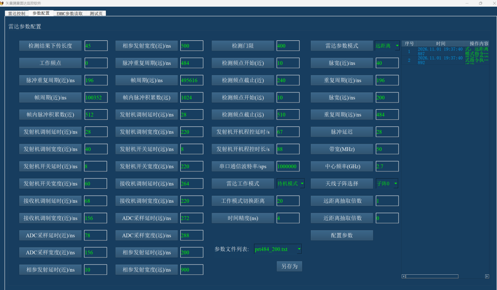
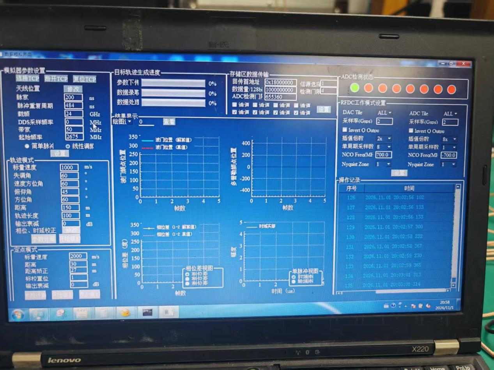

# PL PS 参数与实验设置

本目录记录源码中的固定配置、软件解算参数，以及技术报告中的实验界面设置。源码默认值与某次实验的运行值分别列出；界面截图不能替代寄存器回读。

整理依据：[技术报告](../../report/report.docx)、[PL 源码](../../src/pl)、[PS 源码](../../src/ps)。当前提交基线为不含 MTS 的原版设计，开发工具为 Vivado / Vitis 2021.2。

## 1 PL 固定配置

| 参数 | 配置 | 说明与来源 |
| --- | --- | --- |
| 目标器件 | `xczu47dr-ffve1156-2-i` | RFSoC 开发板 |
| 顶层模块 | `Signal_Processor_Top` | [顶层源码](../../src/pl/new/Signal_Processor_Top.v) |
| 接收通道数 | 5 路复数通道 | 每路 I、Q 各 16 bit |
| 通道 1 | `m32_axis_tdata` / `m33_axis_tdata` | 分别为 I / Q |
| 通道 2 | `m30_axis_tdata` / `m31_axis_tdata` | 分别为 I / Q |
| 通道 3 | `m22_axis_tdata` / `m23_axis_tdata` | 分别为 I / Q |
| 通道 4 | `m20_axis_tdata` / `m21_axis_tdata` | 分别为 I / Q |
| 通道 5 | `m12_axis_tdata` / `m13_axis_tdata` | 分别为 I / Q |
| RF-ADC 采样率 | 4 GS/s | RFDC IP 配置 |
| RFDC 接收抽取倍数 | 16 | 4 GS/s 抽取至 250 MS/s |
| ADC 数字混频设置 | 2.7 GHz | RFDC NCO 配置，不能与 PS 解算载频混用 |
| 接收主处理时钟 | 250 MHz | 周期为 4 ns |
| RF-DAC 采样率 | 8 GS/s | DAC Tile 0；使用 `s00`、`s02` 输出支路 |
| DAC 数字接口时钟 | 500 MHz | 发射及参考波形输出接口 |
| AXI、控制接口及串口逻辑时钟 | 100 MHz | 具体连接见顶层和 BD |
| ADC 多 Tile 同步配置 | 未启用 MTS | ADC Tile 0～3 的 `Multi_Tile_Sync=false`；不据此声称跨 Tile 绝对相位同步 |

RFDC 参数来源：[usp_rf_data_converter_0.xci](../../src/pl/sources_1/ip/usp_rf_data_converter_0/usp_rf_data_converter_0.xci)。固定 IP 参数的变更通常需要重新生成硬件，不能仅靠修改上位机输入框生效。

## 2 接收处理与波形参数

| 参数 | 近程 | 远程 | 参数性质 |
| --- | --- | --- | --- |
| 慢时间 FFT 点数 | 512 | 1024 | [top_fft.v](../../src/pl/new/top_fft.v) 与 PS 常量 |
| 每帧脉冲数 | 512 | 1024 | 常用实验配置；PL 相应计数寄存器存 N−1 |
| PRT | 196 ns | 484 ns | 报告配置及 PS 默认值 |
| 名义帧周期 | 100352 ns | 495616 ns | 与 N×PRT 一致；不是处理延迟实测值 |
| LFM 脉宽 | 40 ns | 200 ns | PS 默认值及上位机配置截图 |
| LFM 带宽 | 50 MHz | 50 MHz | PS `BANDWIDTH` 常量；匹配滤波 ROM 需与输入波形相匹配 |
| 脉冲压缩 FFT / IFFT 点数 | 128 / 128 | 128 / 128 | 独立于慢时间 FFT 的点数 |
| 单个脉压单元输入有效样本数 | 49 | 60 | 其余样本补零至 128 点 |
| 单个脉压单元输出截取点数 | 48 | 61 | 固定 RTL 参数；不是整帧脉冲数 |
| 每通道脉压单元数 | 3 | 3 | 轮转处理，五通道合计 15 个单元 |
| PS `near/far_beishu` 初值 | 0 | 1 | 通过参数命令可更新 |
| PS 距离换算采用的采样率 | 250 MS/s | 125 MS/s | `250e6 / (beishu + 1)`；不等于 RF-ADC 模拟采样率 |

来源：[脉压单元](../../src/pl/Pulse_Compress/ch_pulse_compression_unit.v)、[单通道轮转结构](../../src/pl/Pulse_Compress/ch_pulse_compression.v)、[PS 算法参数](../../src/ps/dataprocess.h)、[PS 换算实现](../../src/ps/bram.c)。

启用脉压时，顶层将 Buffer 的额外抽取控制 `decim_factor` 置为 0；旁路时才选择配置的抽取值。因此，RFDC 的 16 倍抽取、Buffer 抽取控制和 PS 距离换算中的 `beishu` 必须分别理解，不能重复相乘后直接当作脉压输出的实际采样率。

报告“整体介绍”中将脉压单元写为 1024 点 FFT，与当前源码不一致；此处按实际 RTL 记录为 **128 点**。1024 点对应远程慢时间 FFT。

## 3 PS 解算与通信参数

| 参数 | 源码配置或含义 | 来源 |
| --- | --- | --- |
| 处理器与任务组织 | Cortex-A53，FreeRTOS | `main.c`；平台配置见构建说明 |
| 光速常量 | `299792458 m/s` | `dataprocess.h` |
| 频点码初值 | `FreqCode=200` | `bram.c` |
| 解算载频公式 | `f0 = 24e9 + freqcode × 10e6 Hz` | `bram.c`；码 200 对应 26 GHz，码 0 对应 24 GHz |
| 测角短基线 | `0.5 × c / 26e9`，约 5.765 mm | `dataprocess.c` 中固定的几何参数 |
| 测角长基线 | `3 × c / 26e9`，约 34.591 mm | 同上；改变载频不自动改变物理基线 |
| X 方向相位差 | CH4−CH1、CH5−CH1 | 分别对应短、长基线 |
| Y 方向相位差 | CH2−CH1、CH3−CH1 | 分别对应短、长基线 |
| PL 相位字换算 | 有符号 16 位整数 / 8192，单位 rad | `bram.c` |
| 馈线相位补偿 | 两组，每组 4 个相位差；初值均为 0 rad | `FeederPhaseComp_1/2`，可由参数读取更新 |
| 距离换算 | 距离门索引经三点峰值插值，再进行距离与速度耦合补偿 | `bram.c`、`dataprocess.c` |
| 角度输出顺序 | `ResultTrans[0]` 方位角，`[1]` 俯仰角 | `dataprocess.c`、`bram.c` |
| 其他解算输出 | `ResultTrans[2]` 距离，`[3]` 径向速度 | `bram.c` |
| 默认板卡 IPv4 | `192.168.2.101` | DHCP 成功时可能使用分配地址；本值为默认/回退地址 |
| 子网掩码 / 网关 | `255.255.255.0` / `192.168.2.1` | `main.c` |
| UDP 端口 | 5011 | `udp_perf_server.h` |
| 默认上位机地址 | `192.168.2.112` | 收到命令后，部分发送路径改用命令来源地址 |
| 状态报文 | 100 byte，任务间隔 1000 ms | `UdpSendtoUPMTask` |
| PL 测量记录批量上传 | 每条 11×32 bit=44 byte；30 条合计 1320 byte | `bram.c`、`UdpMeasDatSendTask`；这是打包的 PL 记录，不能直接当作 30 条完整角度解算结果 |

源码入口：[dataprocess.c](../../src/ps/dataprocess.c)、[bram.c](../../src/ps/bram.c)、[main.c](../../src/ps/main.c)、[UDP 实现](../../src/ps/udp_perf_server.c)、[UDP 定义](../../src/ps/udp_perf_server.h)。

**频率口径：** RFDC 的 2.7 GHz、模拟器界面的载频和 PS 的 `f0` 是不同位置的参数。报告参数截图显示工作频点 0，模拟器截图显示载频 24 GHz；若实际下发码为 0，PS 按公式采用 24 GHz。源码初值 26 GHz不能代替该次实验的运行值，实际采用的频点应结合配置应答或回读确认。

## 4 报告中的上位机配置

下面原样记录报告参数页面的显示值，不将其写作所有测试点均已回读确认的状态。

| 界面参数 | 近程显示值 | 远程显示值 | 单位 |
| --- | --- | --- | --- |
| 脉冲重复周期 | 196 | 484 | ns |
| 帧周期 | 100352 | 495616 | ns |
| 帧内脉冲积累数 | 512 | 1024 | 个 |
| 发射机调制延时 | 28 | 28 | ns |
| 发射机调制宽度 | 40 | 220 | ns |
| 发射机开关延时 | 8 | 8 | ns |
| 发射机开关宽度 | 60 | 220 | ns |
| 接收机调制延时 | 68 | 264 | ns |
| 接收机调制宽度 | 156 | 220 | ns |
| ADC 采样延时 | 78 | 272 | ns |
| ADC 采样宽度 | 156 | 288 | ns |
| 相参发射延时 | 10 | 200 | ns |
| 相参发射宽度 | 500 | 900 | ns |
| 检测频点开始 | 10 | 10 | bin |
| 检测频点截止 | 240 | 510 | bin |
| 脉宽 | 40 | 200 | ns |
| 抽取控制值 | 0 | 1 | `beishu` / 控制值 |

| 公共设置 | 页面显示值 |
| --- | --- |
| 雷达参数模式 | 远距离 |
| 雷达工作模式 | 待机模式（该截图状态） |
| 天线子阵选择 | 子阵 0 |
| 工作频点 | 0（频点码，不是 0 Hz） |
| 中心频率 | 2.7 GHz |
| 带宽 | 50 MHz |
| 检测门限 | 400（界面/寄存器数值，不能直接写成 400 dB） |
| 检测结果下传长度 | 45（沿用界面名称，单位未注明） |
| 串口通信波特率 | 1000000 sps（界面标注） |
| 发射机开程控延时 / 时长 | 67 s / 88 s |
| 工作模式切换距离 | 20（界面未标单位） |
| 脉冲延迟 | 28（界面未标单位） |
| 时间精度 | 4 ns |
| 参数文件列表项 | `prt484_200.txt`（仅记录列表名称，本目录未附该原始文件） |

其中时序字段为界面值；如 78 ns 等不是 4 ns 整数倍的显示值，实际写入计数器时如何取整，需要结合上位机换算和 PL 回读核对。界面“待机”状态也不能作为接收已经使能的证据。

### 外部回波模拟器

图中波形设置为线性调频，脉宽 200 ns、PRT 484 ns、带宽 50 MHz、起始频率 2675 MHz，载频字段为 24 GHz。定点模式栏显示标量速度 2000 m/s、距离 30 m、距离矫正 27 m、标校置位 1、输出衰减 0 dB。照片中也同时存在轨迹模式参数；是否生效应以模拟器实际选择的模式为准。

模拟器右侧的 RFDC 配置属于外部模拟器，不能作为本项目 RFDC 采样率的配置依据。其余测距、测速、测角测试点见 [结果说明](../results/readme.md)。

## 5 关键控制参数

PS 通过 AXI/BRAM 参数接口写入 PL。下表为相对参数接口基地址的字节偏移，具体写法见 [BramParamSetToPL_32](../../src/ps/bram.c) 与 [参数解析 RTL](../../src/pl/new/Analysis_RadarParameter.v)。

| 偏移 | 参数 | 典型值或编码 |
| --- | --- | --- |
| `0x0004` | 发射控制 | 低 8 位 `0xFF` 开启，`0x00` 关闭 |
| `0x0008` | 接收控制 | 低 8 位 `0xFF` 开启，`0x00` 关闭；PS 常用写入值 `0xFFFFFFFF` |
| `0x0014` | 工作频点码 | PS 同步更新 `FreqCode`，参与载频换算 |
| `0x0018` / `0x004C` | 近程 / 远程 PRT | 常用计数值 48 / 120，对应 `(计数值+1)×4 ns` |
| `0x001C` / `0x0050` | 近程 / 远程帧周期 | 常用计数值 25087 / 123903 |
| `0x0020` / `0x0054` | 近程 / 远程每帧脉冲数 | 常用计数值 511 / 1023，对应 512 / 1024 个脉冲 |
| `0x00B0` | 远近程参数模式 | `0x00` 近程，`0x11` 远程，`0x22` 自动切换 |
| `0x00F4` / `0x00F8` | 远程 / 近程抽取控制值 | 软件初值 1 / 0；更新时也影响 PS 距离换算 |
| `0x00FC` | 标校 / 测量状态 | PS 流程使用 `0x01` 标校、`0x02` 测量 |
| `0x0108` | 脉压 / 旁路选择 | 低 8 位 `0xFF` 启用脉压，`0x00` 旁路 |

以上是参数说明，不是脱离 PS 初始化后直接盲写硬件的操作脚本。开始实测时，应确认接收使能已打开、参数已下发，并保留所用 bit / ELF 的版本。

## 6 VIO 与 ILA

归档设计的 VIO 初值为：参考频点 `ref_freq_in=127`、参考距离门 `ref_bomen_in=16`、判决参数 `judge_num=3`、`judge_num_detect=2`。这四个输出不包含接收启动开关。来源：[vio_0.xci](../../src/pl/sources_1/ip/vio_0/vio_0.xci) 与顶层连接。

| ILA 参数 | 提交源码的原设计 | 延迟测试工程截图 |
| --- | --- | --- |
| 深度 | 2048 | 65536 |
| 观察信号 | 多个数据及控制探针 | `frame_ref_fft`、`fft_refresh` 两个 1 bit 信号 |
| 采样时钟 | 250 MHz | 250 MHz |
| 触发条件 | 按测试目的设置 | `frame_ref_fft == R` |
| 触发位置 | 按测试目的设置 | 32 |

两者属于不同调试配置。报告中的双探针截图不能用来说明归档 bit 已包含深度 65536 的 ILA；资源占用也应与实际采用的实现版本对应。
