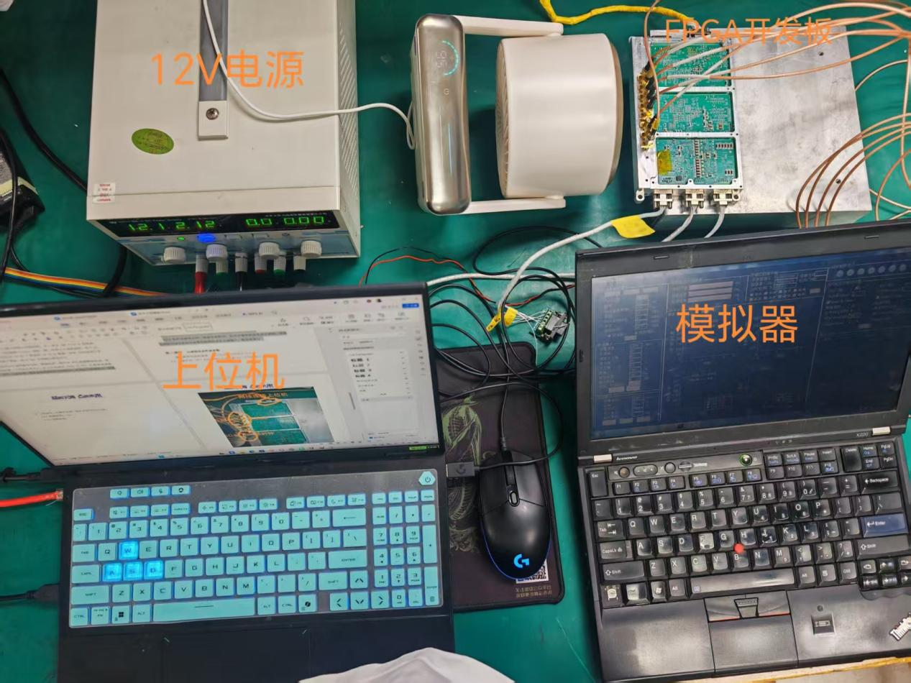
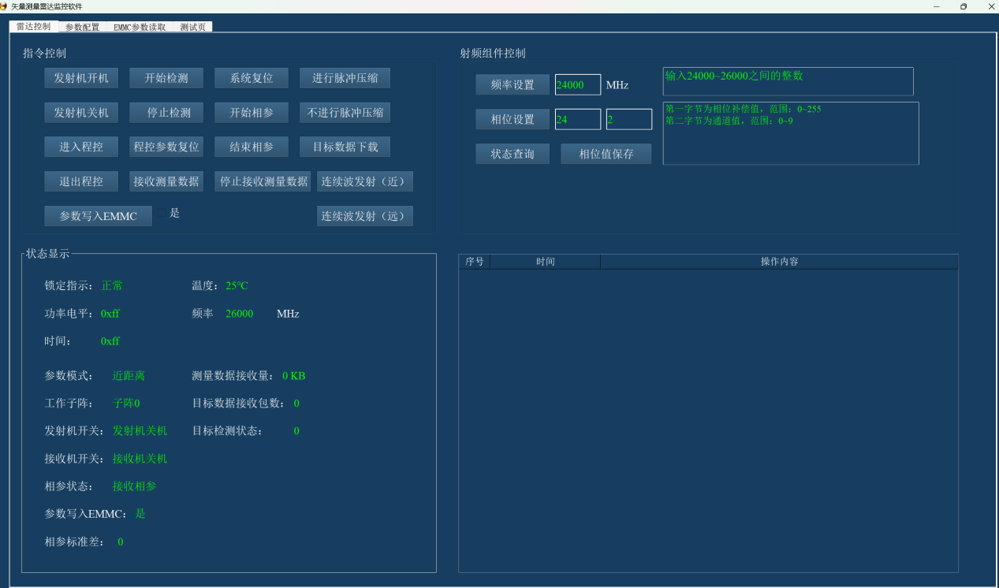
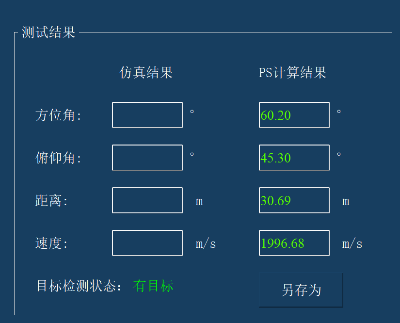
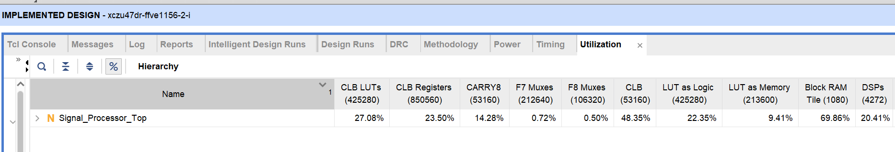
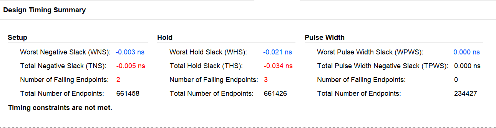
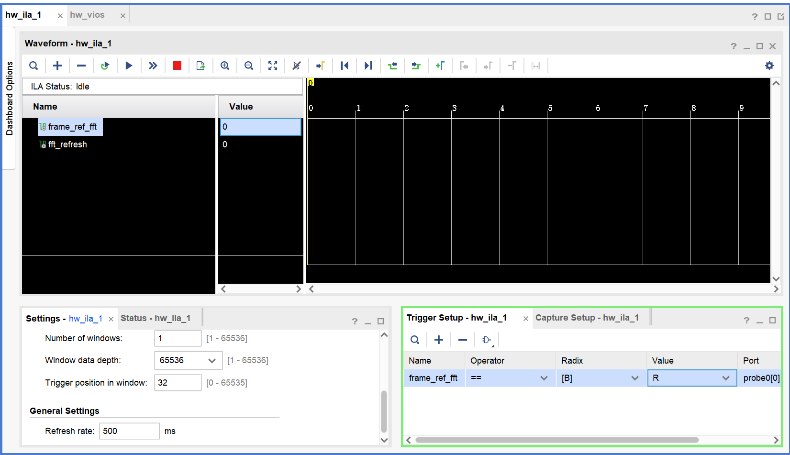

# 实验过程与结果

本目录整理 [技术报告](../../report/report.docx) 中已有的回波模拟器测试记录、上位机显示和 PL 实现结果。测量表格按报告录入，误差由这些记录计算；本目录没有新增上板实验。

测试参数见 [参数说明](../parameters/readme.md)。这些是有限测试点的结果，报告未提供每点重复次数、原始网络报文或完整 I/Q 采样，不能据此给出重复性、置信区间或全工作范围精度保证。

## 1 实验装置与过程



实验由 RFSoC 信号处理板、12 V 电源、回波模拟器和上位机组成。报告描述由模拟器提供五通道回波，板端完成处理和 PS 解算，再由上位机显示。

报告采用的主要设置为：线性调频、远距离模式、PRT 484 ns、每帧 1024 个脉冲，波形设置见参数目录中的截图。

测试流程：

1. 按连接图接好电源、五通道信号线、以太网和调试接口。
2. 加载测试所用 PL bit，运行对应 PS 程序，完成参数下发和接收使能。
3. 在模拟器中设置距离、速度和角度，确认目标及标校状态。
4. 待显示稳定后记录上位机读数；分别改变距离、速度或角度，保留参考值与读数。
5. 用 Hardware Manager 或实现报告记录 PL 状态、资源及调试波形。下载、复位和 ILA 采集分阶段进行，采集中不重新下载或复位。

上板产物见 [build/artifacts](../../build/artifacts)。当前项目保留的旧 XSA 与独立 bit 组合按既有说明使用，本次没有更换它们。

## 2 上位机结果展示





结果示例图显示：方位角 60.20°、俯仰角 45.30°、距离 30.69 m、速度 1996.68 m/s，目标状态为“有目标”。这是报告中的一次独立界面展示，不与下面各表的记录强行配对，也不混入误差统计。

## 3 测量记录与误差

误差统一按下列定义计算：

```text
有符号误差 = 上位机读数 − 模拟器参考值
绝对误差 = |上位机读数 − 模拟器参考值|
相对误差 = 绝对误差 / |模拟器参考值| × 100%
```

“上位机读数 / 参考值”是比值，不是相对误差。角度以度为单位记录绝对误差。

### 3.1 距离

报告给定条件：速度 2000 m/s、俯仰角 45°、方位角 60°，改变目标距离。

| 参考距离 / m | 上位机距离 / m | 有符号误差 / m | 绝对误差 / m | 相对误差 | 记录状态 |
| ---: | ---: | ---: | ---: | ---: | --- |
| 30 | 30.73 | +0.73 | 0.73 | 2.433% | 常规测试点 |
| 40 | 40.86 | +0.86 | 0.86 | 2.150% | 常规测试点 |
| 50 | 50.38 | +0.38 | 0.38 | 0.760% | 常规测试点 |
| 60 | 60.77 | +0.77 | 0.77 | 1.283% | 常规测试点 |
| 70 | 0.19 | −69.81 | 69.81 | 99.729% | 异常点；报告记为距离模糊，单列保留 |

前四个常规测试点的最大绝对误差为 **0.86 m**，平均绝对误差为 **0.685 m**。70 m 异常点未参与这两项常规统计。

70 m 点说明该次配置下出现异常，尚不足以单独确定严格的无模糊距离边界。报告对该点的距离模糊解释应结合接收门控、延迟校准和实际配置进一步核对。

### 3.2 速度

报告给定条件：距离 30 m、俯仰角 45°、方位角 60°，改变目标速度。

| 参考速度 / (m/s) | 上位机速度 / (m/s) | 有符号误差 / (m/s) | 绝对误差 / (m/s) | 相对误差 | 记录状态 |
| ---: | ---: | ---: | ---: | ---: | --- |
| 1000 | 997.44 | −2.56 | 2.56 | 0.256% | 检出 |
| 2000 | 1996.76 | −3.24 | 3.24 | 0.162% | 检出 |
| 3000 | 2995.78 | −4.22 | 4.22 | 0.141% | 检出 |
| 7000 | 未显示数值 | — | — | — | 无目标；报告记为速度模糊 |

三个有数值记录的测试点，最大绝对误差为 **4.22 m/s**，平均绝对误差为 **3.34 m/s**。7000 m/s 的“无目标”不写作 0 m/s，也不参与误差统计；未检出本身不能单独证明具体失效机制。

### 3.3 角度

报告未逐点补充本组测试的距离和速度条件，以下仅整理其明确给出的角度对照值。列顺序为“俯仰角、方位角”，与上位机结果页面的显示顺序不同。

| 参考俯仰角 / ° | 参考方位角 / ° | 上位机俯仰角 / ° | 上位机方位角 / ° | 俯仰绝对误差 / ° | 方位绝对误差 / ° |
| ---: | ---: | ---: | ---: | ---: | ---: |
| 45 | 60 | 44.28 | 59.02 | 0.72 | 0.98 |
| 60 | 45 | 60.26 | 45.11 | 0.26 | 0.11 |
| 30 | 90 | 29.78 | 90.44 | 0.22 | 0.44 |
| 90 | 30 | 89.06 | 31.01 | 0.94 | 1.01 |

四个测试点中，俯仰角最大绝对误差为 **0.94°**，平均绝对误差为 **0.535°**；方位角最大绝对误差为 **1.01°**，平均绝对误差为 **0.635°**。

## 4 PL 资源与时序

### 4.1 资源占用



| 资源 | 使用量 | 器件可用量 | 占用率 |
| --- | ---: | ---: | ---: |
| CLB LUT | 115166 | 425280 | 27.08% |
| CLB Registers / FF | 199913 | 850560 | 23.50% |
| Block RAM Tile | 754.5 | 1080 | 69.86% |
| DSP | 872 | 4272 | 20.41% |

数据来自报告中的原工程整体实现结果，包括该版本中的调试逻辑。BRAM 占比最高，是继续增加缓存和处理规模时需要重点评估的资源。表中没有功耗测量值，不能据此填写功耗指标。

临时双探针、深度 65536 的延迟测试工程改变了调试资源配置，不能直接沿用本表作为该测试工程的资源报告。

### 4.2 时序结果



| 项目 | 截图记录 |
| --- | ---: |
| 最差建立时间裕量 WNS | −0.003 ns |
| 总建立时间负裕量 TNS | −0.005 ns |
| 建立时间违例端点 | 2 |
| 最差保持时间裕量 WHS | −0.021 ns |
| 总保持时间负裕量 THS | −0.034 ns |
| 保持时间违例端点 | 3 |
| 最差脉宽裕量 WPWS | 0.000 ns |

截图明确显示 `Timing constraints are not met`。该版本已有生成 bit 和报告中的板级结果，但尚不能声称时序全部收敛。完整材料见 [综合与实现报告](../../build/reports/sys_impl_report.docx)。

## 5 处理延迟与尚未形成的结果

### 5.1 延迟测量口径



报告提供的这张图为 ILA 配置界面：状态是 `Idle`、波形区空白，没有可用于计算的两个边沿。因此本目录暂不填写处理延迟数值，也不把该图写作延迟测量通过。

根据 [顶层连接](../../src/pl/new/Signal_Processor_Top.v) 与 [FFT 结果输出逻辑](../../src/pl/new/top_fft.v)，正确的起止定义为：

| 信号 | 作用 | 测量位置 |
| --- | --- | --- |
| `frame_ref_fft` | Buffer 提供的 FFT 启动标志，接入 `top_fft.p_b_in` | 起点，取上升沿 |
| `fft_refresh` | 接自 `top_fft.max_dout_en`，表示结果寄存器刷新 | 终点，取同一帧对应的上升沿 |

报告中这两个信号的解释写反了。Hardware Manager / ILA 观察属于板上实测，不是 RTL 仿真。

```text
采样时钟：250 MHz
时间分辨率：4 ns
测量值：T = (fft_refresh 边沿位置 − frame_ref_fft 边沿位置) × 4 ns
```

该指标应命名为“缓存就绪后的 PL 帧处理延迟”，不包含之前的数据采集和脉冲压缩，也不包含 PS 解算及网络传输。65536 点的连续采样窗口约为 262.144 μs；窗口长度和时间分辨率都不是处理延迟本身。

接收使能默认关闭，需要先完成参数配置和接收启动。ILA 的 `Run Trigger` 仅启动观测，不会自动启动业务处理。噪声输入可以用于检查固定处理流程的时间间隔，但需确认两个边沿来自同一帧。

### 5.2 结果状态

| 项目 | 当前材料状态 |
| --- | --- |
| 距离、速度、角度对照 | 已有报告表格，见第 3 节 |
| PL 资源占用 | 已有实现截图，见第 4 节 |
| 时序 | 已有摘要，仍有负裕量 |
| 缓存就绪后的 PL 帧处理延迟 | 待提供包含两个有效边沿的截图或导出数据 |
| PS 解算耗时、端到端延迟 | 尚无本次实测记录 |
| 脉压峰值旁瓣比 PSLR | 尚无板上输入/输出 I/Q 或主旁瓣测量结果 |
| 功耗 | 尚无测量结果 |

后续有实测结果时，在对应小节增加原图、参数、原始导出和计算过程即可，无需另建启动日志目录。

## 6 图片来源与仿真入口

| 本目录图片 | 原始来源 |
| --- | --- |
| `images/test_setup.jpeg` | 技术报告，第三部分整体介绍，内嵌 `image14.jpeg` |
| `images/pc_overview.png` | 技术报告，上位机页面展示，内嵌 `image15.png` |
| `images/pc_result_example.png` | 技术报告，性能截图，内嵌 `image2.png` |
| `images/pl_utilization.png` | 技术报告，硬件占用情况，内嵌 `image20.png` |
| `images/ila_setup_unmeasured.png` | 技术报告，单帧处理延迟，内嵌 `image19.png` |
| `images/pl_timing_summary.png` | 综合与实现报告，时序与待解决问题，内嵌 `image5.png` |

图片从 DOCX 内嵌媒体原样提取，未重绘或改写读数。参数目录的两张图片分别来自技术报告的 `image17.png` 和 `image18.jpeg`。

已有 RTL / IP 仿真材料保持在 [sim](../../sim)，本目录不重复复制：

- [五通道脉压仿真记录](../../sim/results/pulse5.csv)
- [脉压输出记录](../../sim/results/dout_out.csv)
- [FFT 仿真记录](../../sim/results/fft.csv)
- [缓存仿真记录](../../sim/results/buffer.csv)

这些是仿真数据，不能代替本节板级结果或未经验证的脉压 PSLR。仿真记录中的行数也不等于连续时钟周期数。重新运行仿真前，应按当前源码目录结构核对 [仿真说明](../../sim/README.md) 与脚本依赖。
